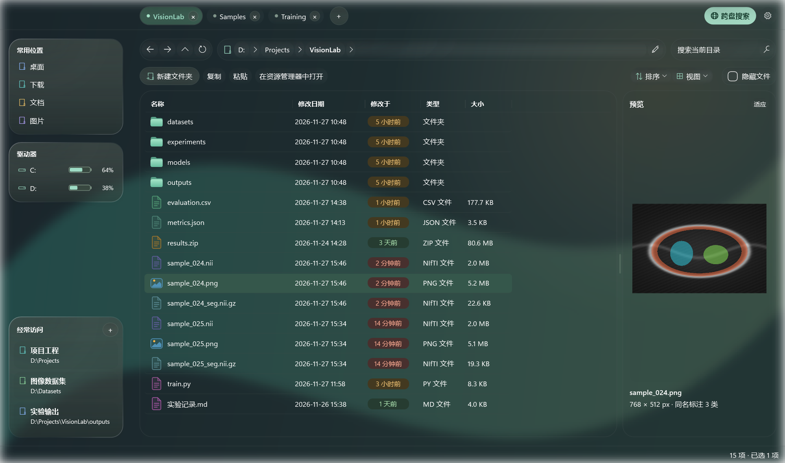
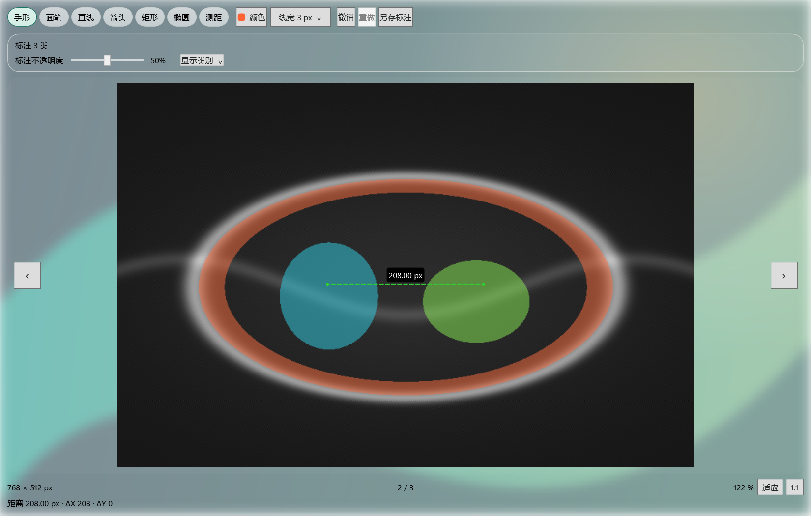
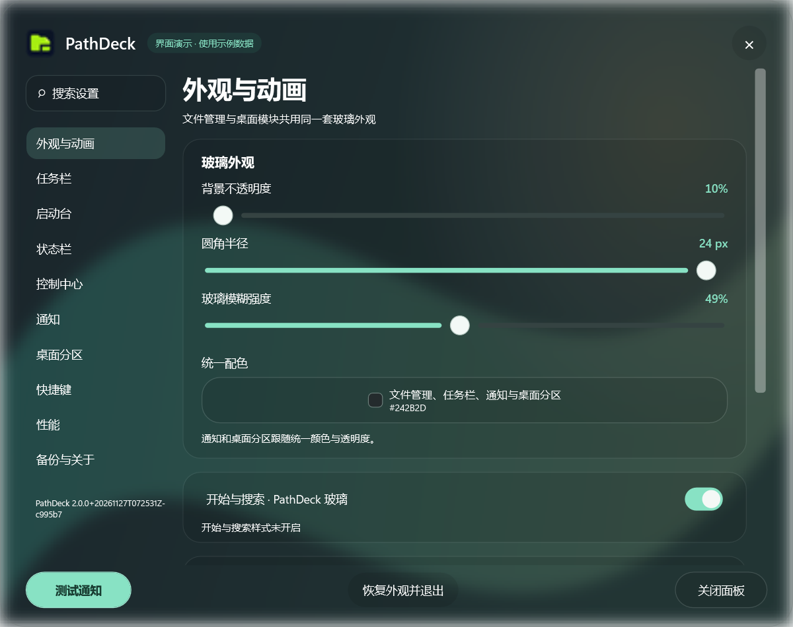
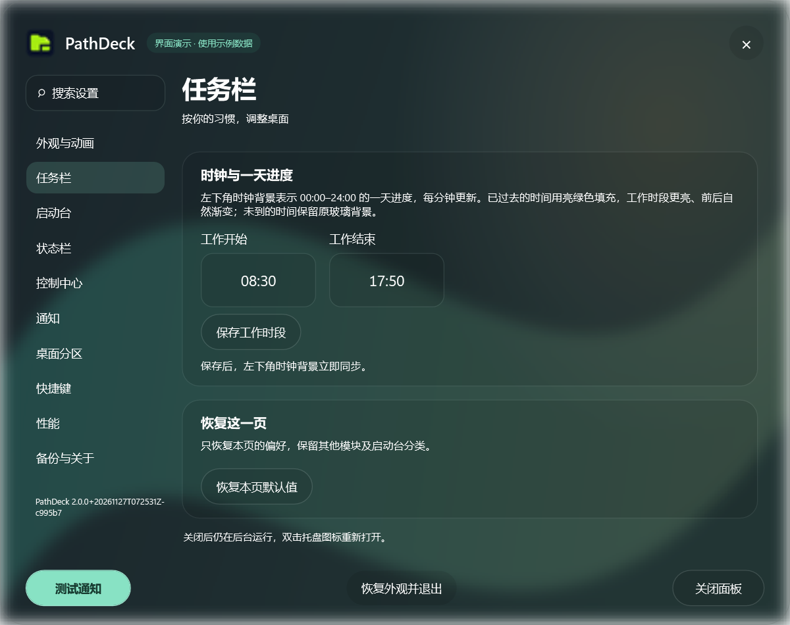
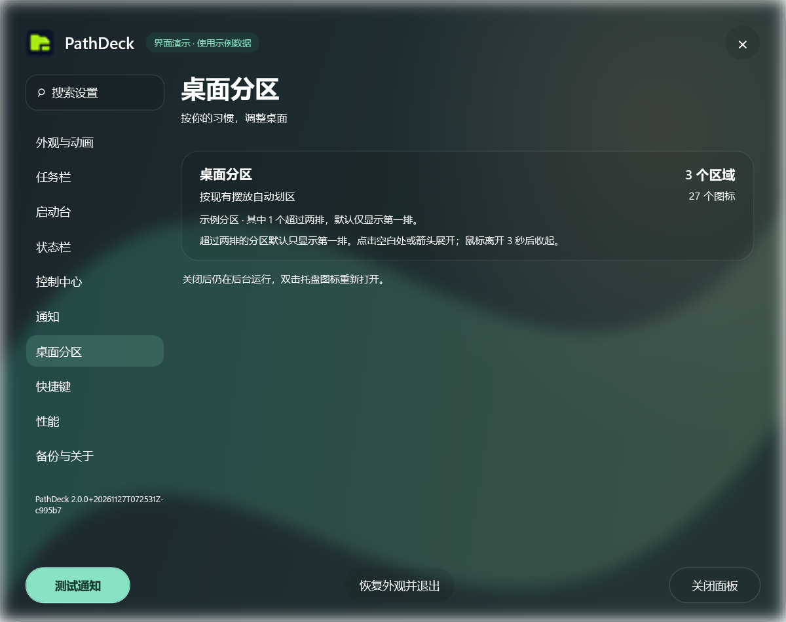

# PathDeck · 文件管理与桌面工具

PathDeck 是面向 Windows 的便携文件管理器，将多标签浏览、跨盘搜索、图像复核与玻璃桌面工具整合在同一个软件中。适合在项目工程、数据集和实验输出之间频繁切换。

**当前稳定版：2.0.0** · [下载 Windows x64 便携版](https://github.com/wangduyang/PathDeck/releases/download/v2.0.0/PathDeck-2.0.0-win-x64.zip) · [发布说明](https://github.com/wangduyang/PathDeck/releases/tag/v2.0.0) · [SHA256 校验文件](https://github.com/wangduyang/PathDeck/releases/download/v2.0.0/SHA256SUMS.txt)



截图使用 **2.0.0 的真实界面控件和演示数据**，仅展示应用内容区域。目录、图像、消息与背景均为演示内容，不包含个人文件或聊天信息；不同截图展示不同的共享配色。

## 可以做什么

| 模块 | 主要功能 |
| --- | --- |
| 文件管理 | 多标签、路径面包屑、固定位置、颜色标签、相对修改时间、右键终端与 PyCharm、压缩解压与删除进度。 |
| 快速检索 | 优先使用 Everything；未安装、未运行、连接错误或超时时自动尝试 Windows Search，显示当前引擎与索引范围。 |
| 图像复核 | 右侧预览、按列表顺序翻图、滚轮缩放和平移、像素读数、绘图测距与另存标注副本。 |
| 多图与分割 | 同尺寸窗口联动缩放、平移及指针；配对单层 `.nii` / `.nii.gz` 原图与多类别标签，调整叠加不透明度和类别显示。 |
| 桌面工具 | 任务栏玻璃、可折叠桌面分区、独立通知卡片、一天进度时钟，以及可选的顶部状态栏、启动台与控制中心。 |
| 共享外观 | 文件管理、任务栏、通知及桌面分区共享颜色、不透明度和模糊参数，保留清晰的文字与图像前景。 |

原 TaskGlass 已整合为 PathDeck 桌面模块，共用 `PathDeck.exe`、运行时与产品图标；无需运行另一个 TaskGlass 工程。

## 界面一览

### 图像与多类别标注复核



同名原图与标签一起展示，按类别控制显隐；滚轮缩放、拖动平移、像素测距与标注导出可在同一窗口完成。原图被外部重新生成时，会提示保留旧图和标注，或重新加载并放弃旧标注。

当前支持单层 NIfTI-1；不是完整的 DICOM 序列或三维切片查看器。空间信息无法确认或不匹配时会停用叠加。

### 时钟进度与独立通知


时钟背景表示 **00:00–24:00** 的一天进度，每分钟更新。已过去的时间连续渐变，工作时段更亮，未到的时间保留原玻璃背景。工作时间可在设置中修改。

提醒以独立卡片显示；点击卡片打开来源，通过其他方式进入来源应用后也会自动收起。可显示的正文取决于来源软件，无法读取摘要时显示“有新消息”。上图是组件演示，不是真实聊天记录。

### 外观、工作时段与桌面分区

<details open>
<summary>共享玻璃外观</summary>



从托盘右键打开“桌面与任务栏设置…”→“外观与动画”，统一调整玻璃材质。文件管理窗口随之同步。

</details>

<details>
<summary>工作时段与一天进度</summary>



默认工作时段为 **08:30–17:50**。保存后，时钟背景的高亮范围立即同步。

</details>

<details>
<summary>桌面分区与自动折叠</summary>



按桌面图标现有摆放识别区域。超过两排的分区默认显示第一排，点击空白处或箭头展开；鼠标离开 3 秒后收起，移回取消，拖动期间暂停计时。原有图标位置和源文件保持不变。

</details>

## 下载并运行

1. 下载 [PathDeck-2.0.0-win-x64.zip](https://github.com/wangduyang/PathDeck/releases/download/v2.0.0/PathDeck-2.0.0-win-x64.zip)，完整解压到有写入权限的目录。
2. 双击 `PathDeck.exe`。包内已包含 .NET 桌面运行时，无需另装 .NET。
3. 文件管理右上角齿轮打开“文件管理设置”；托盘右键进入“桌面与任务栏设置…”。

Windows x64 便携版已在 Windows 11 x64 验证。需要核对下载完整性时，对照 [SHA256SUMS.txt](https://github.com/wangduyang/PathDeck/releases/download/v2.0.0/SHA256SUMS.txt) 检查 ZIP 的 SHA256。

## 设置入口

| 入口 | 管理内容 |
| --- | --- |
| 文件管理右上角齿轮 | 默认文件管理器、Win+E、右键菜单，以及“使用说明与演示”。 |
| 托盘右键 → 桌面与任务栏设置… | 共享外观、工作时段、通知、桌面分区、状态栏、启动台、控制中心及桌面模块备份。 |
| 托盘右键 → 开机启动 | 登录后后台启动 PathDeck；文件窗口按需打开。 |

两处功能设置分别管理，颜色、不透明度和模糊度实时同步。桌面模块的配置导出范围不包含文件管理的固定路径，升级时仍需保留下面列出的文件。

## 从旧版升级

1. 退出 PathDeck，先备份原应用目录内的个人配置。
2. 保留 `pins.json`、`colors.json`、`menu.json`、`appearance.json`、`win-e.enabled`、`Modules/Desktop/settings.json` 及已有的 `Modules/Desktop/Data`。
3. 将新包完整解压到原目录，覆盖程序文件。发行包不携带个人配置与运行日志，保留原配置即可。
4. 继续使用原快捷方式启动；保持便携目录路径不变，可以沿用原有启动项和文件夹关联。

## 2.0 可靠性与性能改进

- 删除保留 Windows 安全确认与左下角进度；无法回收时，以系统的永久删除提示为准。
- 当前目录被外部改名或删除后清空失效列表，原路径恢复后继续刷新。
- Everything 连接错误或超时自动降级，清空旧分页并同步搜索引擎与范围提示。
- 编辑状态绑定源图内容与尺寸，避免旧标注静默套到新图；支持识别同尺寸、同修改时间的内容替换。
- NIfTI 使用归一化单位与像素覆盖范围检查空间匹配，包含微小间距、旋转和单像素轴。
- 修复晚到通知、桌面模块重新打开、最终文字对比度与跨屏玻璃缓存；普通翻页不长期保留未编辑图像快照。

<details>
<summary>此前版本</summary>

[1.0.7](https://github.com/wangduyang/PathDeck/releases/tag/v1.0.7) 引入液态玻璃风格与离线图文使用说明；2.0 将桌面工具整合进同一个软件，并更新了共享外观与设置入口。

</details>

## 同类文件资源管理器比较

| 产品 | 下载或使用费用 | 适用场景 |
| --- | --- | --- |
| **PathDeck** | **便携版免费下载** | 多标签、固定目录与跨盘搜索，内置图像测距、像素读数和 NIfTI 多类别叠加；同时整合玻璃任务栏、桌面分区与通知，适合项目和数据集工作流。 |
| [Windows 文件资源管理器](https://support.microsoft.com/zh-cn/windows/experience/fileexplorer/file-explorer-in-windows) | 随 Windows 提供 | 日常文件管理、系统文件夹、Windows Search 和云文件访问。 |
| [OneCommander](https://www.onecommander.com/) | [个人非商业使用免费，商业使用需购买 Pro](https://www.onecommander.com/pricing) | 多标签浏览、文件与文件夹预览。适合希望使用单栏或双栏来组织文件的用户。 |
| [Double Commander](https://doublecmd.sourceforge.io/index.php?lang=eng) | 免费、开源 | 双栏文件管理、批量重命名和归档浏览。适合在两个目录之间批量处理文件。 |

在 PathDeck 里，可以用跨盘搜索找到一组实验输出，打开所在目录，再按列表顺序翻图、读像素或查看分割标签。


## 运行、构建与验证

开发需要 [.NET 10 SDK](https://dotnet.microsoft.com/download/dotnet/10.0)。归档功能使用 Windows 自带的 [tar.exe](https://learn.microsoft.com/windows/tar/)。

```powershell
git clone https://github.com/wangduyang/PathDeck.git
cd PathDeck
dotnet build .\src\QuickFileDesk.csproj -c Release
dotnet run --project .\src\QuickFileDesk.csproj
```

可以在命令行传入一个文件夹作为起点：

```powershell
dotnet run --project .\src\QuickFileDesk.csproj -- "D:\Work"
```

版本在 `Directory.Build.props` 统一维护。发布脚本在全新目录生成自包含 Windows x64 便携版，验证运行时、原生组件、版本、中文说明和配置隔离，再生成 ZIP 与 SHA256：

```powershell
.\scripts\Build-Portable.ps1
```

桌面模块随主工程构建；第三方引擎位于 `modules/Desktop/Runtime`，输出至 `Modules/Desktop/Engine`。来源与许可证见 [桌面模块说明](modules/Desktop/README.md)。构建标识可从两个设置页查看。

完整回归检查使用合成数据，包含短暂的界面检查；`--core` 运行文件、搜索、图像、通知与缓存的核心回归：

```powershell
dotnet run --project .\tests\PathDeck.Checks.csproj -c Release
dotnet run --project .\tests\PathDeck.Checks.csproj -c Release -- --core
```

用环境变量 `PATHDECK_TEST_ROOT` 指定临时测试目录；默认位于 `D:\codex\.tmp`。仅本机验证过的场景不代表覆盖所有 Windows 版本、网络断连和多显示器配置。

## 日常操作

### 浏览、搜索和整理

地址栏右侧的「搜索当前目录」用于查找当前目录及其子目录。点击窗口顶部的「跨盘搜索」可按文件名查找已索引位置，并按磁盘和类型筛选。双击或按回车打开结果。选中结果后可点击「打开所在文件夹」定位到该项。

搜索页显示当前引擎和索引范围。使用 Windows Search 时，页面按所选盘符显示系统配置的索引目录，悬停可查看完整列表。新增目录需要在 Windows 的「索引选项」中添加并等待建立索引。PathDeck 的固定位置用于快速导航。

Everything 支持查找其索引中的网络共享。以 UNC 路径加入 Everything 索引的共享可以在「全部已索引位置」中搜索。

- 点击标签页旁的「＋」或按 Ctrl+T 会新建「此电脑」标签页。启用 PathDeck 的 Win+E 快捷键后，按 Win+E 打开「此电脑」查看当前驱动器的总容量和剩余容量。双击盘符进入，已有标签页仍可切换。驱动器下方列出「经常访问」，单击即可打开固定的文件夹。

- 地址栏的每一段都可以点击，旁边的箭头打开该层的子文件夹列表。点地址栏空白处或按 `Ctrl+L` 可输入路径。深层路径的前缀会折叠到「…」。
- 地址栏输入 `cmd` 后按回车，可以在当前文件夹打开命令提示符。
- 左侧列出常用位置和驱动器，电池样式的容量条显示磁盘已用百分比。点左下角「经常访问」旁的 `＋` 可固定当前文件夹。右键固定项可设置标签、恢复默认标签或取消固定。每条同时显示标签和完整路径。
- 搜索框按回车按名称查找当前目录及其子目录。按 `Esc` 清除搜索。
- 文件栏上的「排序」支持名称、修改日期、修改于、类型和大小，可以切换升降序以及文件夹是否排在前面。「视图」可以切换详细信息、仅名称、缩略图和小、中、大图标。详细信息和缩略图视图的「修改于」列显示相对时间，用文字和底色标出时间段。当前目录中的新建、删除、重命名和修改会自动刷新列表。
- 文件操作包括复制、剪切、粘贴、重命名、新建、拖放、属性和回收站。同名粘贴会使用带「副本」后缀的名称。本地固定驱动器以外的删除可通过 Windows 资源管理器处理。
- 删除时优先移到回收站，Windows 无法回收时可能要求确认永久删除。左下角会在压缩、解压的同一位置显示动态进度条、当前项目、批量操作到了第几项和已用时间。结束后会显示处理结果。
- 先选中一个文件或文件夹，再慢点一次名称，可直接编辑名称。按回车确认，按 Esc 取消。快速双击会打开该项目。Windows 快捷方式在列表中显示系统图标和快捷方式箭头，指向可访问文件夹的快捷方式会在当前标签页打开。
- 文件和文件夹可以右键设置颜色标签，支持多选。颜色按完整路径保存在本机。在 PathDeck 内移动或重命名时，已有标签会随路径更新。

### 预览图片

单击选中一张图片后，右侧自动展开预览。选中其他文件、文件夹、多项或取消选择时，预览收起。拖动列表和预览之间的短竖线可以调整宽度。滚轮缩放，放大后按住鼠标左键拖动查看，点倍率恢复适应窗口。隐藏后再次打开预览，会恢复同一窗口内调好的宽度。 鼠标指向图片时，预览下方显示从原图左上角 (0, 0) 起算的坐标和灰度或 RGB 值。解码后的像素数据超过 64 MB 时，预览仍显示坐标。

常用图片扩展名包括 PNG、JPEG、BMP、GIF、TIFF 和 ICO。当前预览读取不超过 64 MB 的图片，实际解码能力取决于 Windows 图片编解码器。

双击图片可打开大图窗口。点看图区域两侧的按钮，或按左右方向键，可按打开时文件列表的排序和筛选切换图片。按 Esc 关闭窗口。在大图或文件列表中右键选择「打开方式…」，可用其他软件打开图片。

在大图窗口中，滚轮以鼠标位置为中心缩放。选择「手形」拖动查看，也可以用鼠标中键拖动。「适应」回到适合窗口的大小，「1:1」让原图像素对应屏幕像素。

在同一个 PathDeck 中打开多个大图窗口时，所有图片宽度和高度的像素数都相同才会联动。滚轮缩放、拖动平移、「适应」和「1:1」会同步，其他窗口的对应像素也会显示手形指针。鼠标移出图片时，指针消失。只要有一张图的宽或高不同，整组暂停联动。关闭尺寸不同的图片或换回同尺寸图后，联动自动恢复。换图和标注在各自窗口操作。

- 顶部可选择画笔、直线、箭头、矩形、椭圆或测距工具。「颜色」支持在色谱上拖选、输入 HEX 或 RGB，以及复用当前查看器窗口的最近颜色。撤销和重做分别为 Ctrl+Z、Ctrl+Y。
- 底部显示原图尺寸、鼠标位置的坐标和灰度或 RGB 值。坐标原点在左上角。测距显示两点的欧氏距离及横纵像素差，矩形和椭圆显示包围范围及像素宽高。
- 翻页后再返回，仍能看到这个查看窗口中已画的标注。「另存标注」或 Ctrl+S 将原图和标注合成全尺寸的 8 位彩色 PNG 副本。超大图片可能使用缩小的画面显示，无法导出全尺寸副本。

### 查看 NIfTI 分割

同目录下可配对 `名称.nii` 与 `名称_seg.nii.gz` 或 `名称_mask.nii.gz`，也可配对采用同名 `名称.nii` 和 `名称.nii.gz` 的数据。单击原图、标注或同名 PNG，右侧会显示叠加预览。双击进入大图窗口，左右键按当前文件列表顺序切换数据组。

大图窗口可以调整标注不透明度、按标签编号开关各类分割区域，鼠标下方读数会显示原图灰度和标签值。标签 0 表示背景。当前读取单层 NIfTI-1，尺寸或空间信息不一致时只显示原图并提示。

### 打开方式和归档

- 右键文件列表空白处或单个文件夹，选「在 PyCharm 中打开此工程」或「打开终端」。前者使用本机安装的 PyCharm 打开对应文件夹，后者在该目录启动 Windows 终端。没有 Windows 终端时会打开命令提示符。
- 右键单个文件，选「打开方式…」，在 Windows 应用选择窗口中选择程序。
- 选中一个或多个文件或文件夹，右键选「压缩为」，选择格式并输入压缩包名称。压缩包生成在当前文件夹。
- 右键选中一个支持的压缩包，点「解压到同名文件夹」。程序在压缩包旁创建结果文件夹。同名时会加「副本」后缀。
- 压缩和解压时，左下角显示进度条和「取消」。进度用已写入的大小或正在处理的项目数表示，任务完成后才显示正式结果。取消会清理暂存文件。
- 在右上角 **设置 → 自定义右键菜单**，可以勾选要显示的项目。点「恢复默认」再保存，可重新显示全部项目。

| 格式 | 创建 | 解压 |
| --- | --- | --- |
| ZIP、7z、TAR | 支持 | 支持 |
| TAR.GZ、TAR.BZ2、TAR.XZ | 支持 | 支持 |
| TGZ、TBZ2、TXZ | 使用对应的 TAR 复合扩展名 | 支持 |
| RAR | 需要标准安装位置的 WinRAR 命令行程序 | 支持普通 RAR |

当前菜单面向普通、未加密的归档。密码和分卷归档可交给支持它们的外部应用。归档操作先写入同目录的临时位置，成功后才生成最终结果。解压时保留已有文件夹并拒绝含链接的输出。

## 快捷键

| 快捷键 | 操作 |
| --- | --- |
| `Ctrl+L` 或 `Alt+D` | 编辑地址 |
| `Ctrl+F` | 聚焦搜索 |
| `Ctrl+T` / `Ctrl+W` | 新建 / 关闭标签页 |
| `Alt+←` / `Alt+→` | 后退 / 前进 |
| `Alt+↑` 或 `Backspace` | 上一级。输入框中的 Backspace 仍用于删字 |
| `Ctrl+A` | 全选 |
| `Ctrl+C` / `Ctrl+X` / `Ctrl+V` | 复制 / 剪切 / 粘贴 |
| `Ctrl+Shift+C` | 复制完整路径 |
| `Ctrl+Shift+N` | 新建文件夹 |
| `Enter` / `F2` / `Delete` | 打开 / 重命名 / 删除（优先回收站，留意系统永久删除提示） |
| `Alt+Enter` / `F5` | 属性 / 刷新 |
| `Win+E` | 在设置中启用后打开 PathDeck |

## Windows 集成

右上角齿轮进入「文件管理设置」，管理默认文件夹关联和 Win+E。共享颜色、透明度与模糊度从托盘右键 →「桌面与任务栏设置…」→「外观与动画」调整；任务栏页可设置工作时段，时钟背景每分钟更新当天已过去的进度。开机启动在托盘菜单中单独控制。

| 选项 | 生效方式 | 恢复方式 |
| --- | --- | --- |
| 设为默认文件管理器 | 注册当前账户下普通文件夹和驱动器的默认打开命令 | 点击「恢复原设置」 |
| 开机启动 | 在当前账户的登录启动项中登记便携版程序 | 关闭「开机启动」 |
| 用 Win+E 打开 PathDeck | 运行时接管这个组合键。关闭窗口后程序留在后台响应快捷键 | 关闭「用 Win+E 打开 PathDeck」 |

文件夹关联适用于通过 Windows 默认方式打开的普通文件夹和驱动器。系统桌面、虚拟位置和打开、保存对话框继续由 Windows 提供。移动或删除便携目录前，先恢复默认文件夹关联并关闭开机启动。更新程序文件时可以保留同目录的个人配置。

## 本地配置

| 文件 | 保存内容 |
| --- | --- |
| `pins.json` | 固定路径和显示标签 |
| `colors.json` | 按文件系统路径保存的颜色标签 |
| `menu.json` | 在右键菜单中隐藏的项目 |
| `appearance.json` | 兼容旧版的文件管理外观偏好；共享玻璃外观以桌面设置为准 |
| `win-e.enabled` | Win+E 开关标记 |
| `Modules/Desktop/settings.json` | 共享玻璃外观、工作时间、通知及桌面模块偏好 |
| `Modules/Desktop/Data` | 启动台等模块数据（如果已使用） |

这些文件生成在应用目录中。更新前完整备份这些配置及已有的 `Modules/Desktop/Data`，退出程序后替换程序文件；保留个人配置，不要用发行包覆盖本机配置。开机启动和默认文件夹关联保存在当前用户的 Windows 注册表中。仓库用于保存源码及构建资源，本机路径和个人配置由应用在本地管理。

## 源码导览

| 文件 | 职责 |
| --- | --- |
| `Directory.Build.props`、`src/QuickFileDesk.csproj` | 统一版本、项目目标和图标 |
| `src/MainWindow.xaml`、`src/MainWindow.*.cs` | 浏览窗口、地址栏、视图、预览与文件右键菜单 |
| `src/BrowserData.cs` | 目录读取、固定路径、颜色和便携配置 |
| `src/FileOperations.cs`、`src/FileClipboard.cs` | 文件操作和 Windows 文件剪贴板 |
| `src/ArchiveFiles.cs` | 压缩和解压 |
| `src/FileThumbnail.cs` | 图片解码与后台缩略图 |
| `src/SettingsWindow.xaml`、`src/WindowsIntegration.cs`、`src/WinEShortcut.cs` | 设置、用户级系统关联和快捷键 |
| `src/ControlStyles.xaml` | 弹出菜单与滚动条样式 |
| `modules/Desktop` | 任务栏、桌面分区、通知、状态栏、启动台与共享玻璃材质 |
| `scripts/Build-Portable.ps1`、`scripts/Test-Portable.ps1` | 干净便携构建、内容验证与校验和 |
| `tests/PathDeck.Checks.csproj` | 核心逻辑与界面回归检查 |

修改后可先执行 `dotnet build .\src\QuickFileDesk.csproj -c Release`。在临时目录用样例文件检查右键单选和多选、同名粘贴与解压、缩略图和分隔条。验证系统集成时，在确认生效后可用设置中的恢复入口撤销。
